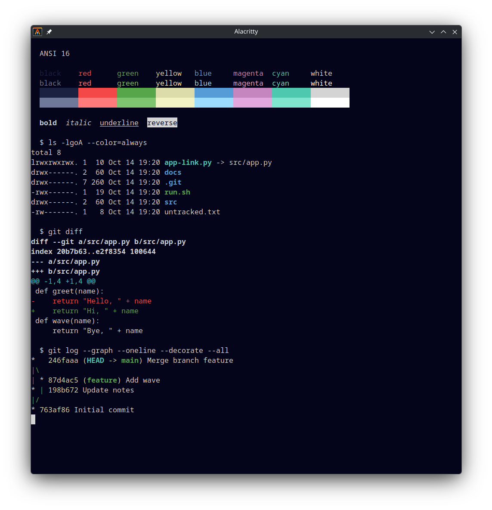

# Deepwick for iTerm2

Deepwick colors for [iTerm2](https://iterm2.com).

> Deepwick is an unofficial theme derived from
> [Polywick Blue](https://vscode.polywickstudio.net) by Polywick Studio (MIT).
> Not affiliated with Polywick Studio.

**Not yet verified in iTerm2.** This preset is generated from the Deepwick
palette and checked by tests, but nobody has looked at it in iTerm2 yet (the
maintainer has no Mac). The preview below shows the preset's colors rendered
in Alacritty, not a screenshot of iTerm2. Reports and screenshots are welcome.

## Install

1. Download `Deepwick.itermcolors`.
2. In iTerm2, open **Settings → Profiles → Colors**.
3. Open **Color Presets…**, choose **Import…** and select the file.
4. Choose **Deepwick** from **Color Presets…**.

## Recommended profile settings

A color preset cannot switch these on, so set them in the same Colors tab:

- **Use Selected Text Color**: on (Foreground on Selection).
- **Use Bright Bold**: off. Bold text then stays Foreground.
- **Use Underline Color**: on (Blue).
- **Use Tab Color**: on (Surface).
- **Use Cursor Guide**: optional (Surface at 25% opacity).

## Notes

- All colors are sRGB.
- Links Orange, search matches on Gold, badge Blue at 50% opacity.
- The preset is generated by `generate.py` from the Deepwick palette.

Tested with the iTerm2 color preset format only (keys from `iTermColorPresets.m`
on iTerm2 master, as of iTerm2 3.5), not in iTerm2 itself.

## License

MIT. See [LICENSE](LICENSE).
